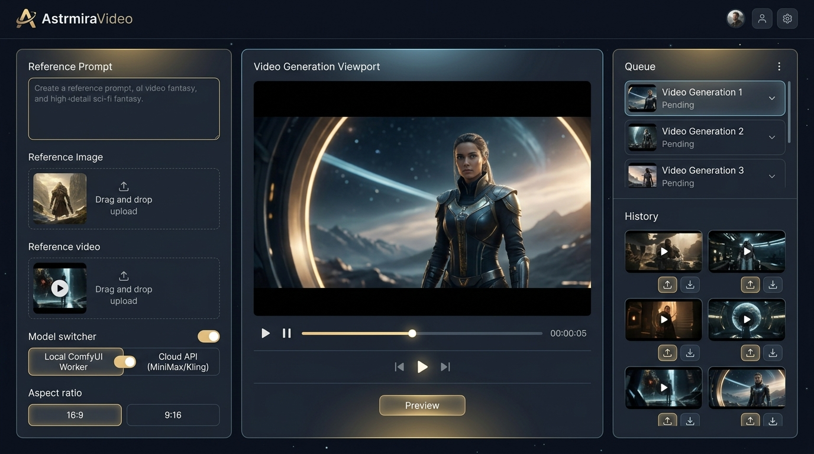

# AstrmiraVideo

> **自然语言描述 + 参考图/参考视频 → 本地/云端双轨 AI 视频生成工作台**

[](docs/PLAN.md)
[](LICENSE)
[](docs/PLAN.md)
[](docs/PLAN.md)

## 30 秒电梯陈述

面向创作者的现代化双轨 AI 视频生成工作台：输入自然语言描述、拖入参考图（首尾帧/风格）或参考视频，按**推荐配置与你自己的选择**路由——**云端火山方舟 Seedance（BYOK 自备 Key，Key 只存你自己的浏览器）** 或 **本地 MiniMax H3（DiffSynth-Studio，由部署者显式启用）**——生成带原生立体声对白的成片。无卡设备零门槛走云端，有卡设备可 0 成本走本地。



## 快速开始

```bash
cp .env.example .env   # 按需填入火山 Key / 本地 H3 目录
pnpm install
pnpm dev               # 并行拉起 backend + frontend
```

> 当前进度：Step 1 骨架【已验证】、Step 1.5 地基整改【已验证】、**Step 3 前端工作台【已验证】**均已完成；**Step 2 剩两项**——AC2 的真实出片冒烟（待一把可用 Key）与 **host 本地轨 `LocalH3Provider` 未实现**（选择本地引擎会如实返回 `PROVIDER_UNAVAILABLE`；OI-1 素材 provider 是非目标，见台账 B7）；**Step 4 端到端验收阻塞于同一把 Key**；**Step 5 已上线，且 CI → CD 全自动**（push 到 main → CI 全绿 → 自动发布到服务器；主机 / 端口 / 凭据只存在于服务器本地 `.env.deploy` 与 GitHub Secrets，不入仓库）；**V8.3 体验与功能补强批次 0~4 与批次 6 已完成**（生成参数与布局 / 主题体系 / 取消与清理 / 画廊封面与首尾帧·视频参考入口 / 提示词扩写 / **线上故障修复 + 操作日志**），仅剩批次 5 = 真实出片冒烟 ——进度唯一权威为 PLAN §5。

填入自己的火山方舟 Key 即可出片（Key 存在**你的浏览器**，服务端过手不留存）；本地轨由**部署者显式启用**（`EXPOSE_HOST_LOCAL_TRACK`），未启用时选择本地引擎会返回 `PROVIDER_UNAVAILABLE`。推荐档位与引擎接入详见 [docs/GUIDE.md](docs/GUIDE.md)。

> **提示词扩写（✨）另需一把文本 Key**：它与视频 Key 是**两套**凭据（可一键复用），在同一个「凭据设置（BYOK）」抽屉里填；服务端**不设文本侧兜底 Key**（纯 BYOK），没填时按钮置灰并写明原因。配置口径见 [docs/GUIDE.md](docs/GUIDE.md) §四，接口与错误码见 [docs/CONTRACT.md](docs/CONTRACT.md) §3。
>
> **提交前先用「测试连接」**（凭据抽屉，**零费用**）：它会回答"Key 行不行 / 模型在不在 / 有没有开通"，免得花一次真实生成换一条报错。视频模型从**档位下拉**里选（默认 `doubao-seedance-2-0-mini-260615`，省钱档）。
>
> **排错入口是顶栏「日志」**：记录"谁、何时、做了什么、结果如何"（明文 IP、可按动作/错误码/关键词筛选、可手动删）。报错时把那条记录的 `requestId` 发给开发者即可一条命中。细则见 [docs/GUIDE.md](docs/GUIDE.md) §七与 [docs/CONTRACT.md](docs/CONTRACT.md) §10。

## 文档地图（每个知识点只有唯一所有者，其他地方只准链接）

| 文档 | 职责 | 独家拥有的内容 |
|---|---|---|
| **README.md**（本文） | 入口与导航 | 电梯陈述、文档地图、协作规范 |
| [docs/PLAN.md](docs/PLAN.md) | 产品与开发规划 | 架构、功能清单、**七道防线**、**Step+AC**、**进度日志**、决策记录、安全合规、成本风险 |
| [docs/CONTRACT.md](docs/CONTRACT.md) | 接口唯一权威 | TS 类型、**路由表**、错误码字典、存储与资产生命周期 |
| [docs/GUIDE.md](docs/GUIDE.md) | 上手指南 | **Tier 0~3 算力矩阵**、双轨引擎接入、四种生成工作流、FAQ |
| [docs/UPSTREAM.md](docs/UPSTREAM.md) | 上游台账 | 参考/复刻项目与版本追溯（含 ffmpeg 等外部工具的来源 / 版本 / 许可证登记） |
| [docs/EXEC-STEP2-5.md](docs/EXEC-STEP2-5.md) | 施工手册（一次性） | Step 2 ~ Step 5 的**唯一施工权威**：分段施工卡、片内改动清单、破坏性验证、证据格式；Step 5 验收后归档删除 |
| [NEXT_SESSION_PROMPT.md](NEXT_SESSION_PROMPT.md) | 跨会话接力 | 纯指针，不含任何独家信息 |

## 协作与文档规范（所有贡献者与 AI 会话必须遵守）

1. **脱敏红线**：IP / 绝对路径 / 凭证永不写入 md，一律 `<占位符>`，真实值只存本地 `.env`（模板：`.env.example`）；
2. **单一事实源**：每个知识点只在 Owner 文档详写一次，引用处只放链接；禁止跨文档复制段落；
3. **每步必带 AC**：任何实施步骤必须附可测试的验收标准与验证方式，否则视为未定义；
4. **一致性自检**：修改方向性结论后，必须全仓检索相关关键词并同步所有受影响文档；
5. **三级标记**：**【已验证】**实测确认 / **【待验证】**未经实测 / **【规划】**尚不存在——未标注的事实性数字视为【待验证】；
6. **进度回检**：任何 Step 状态变更（开工 / 完工 / 阻塞）必须在**同一提交**内回检三处指针——README 徽章与「快速开始」段、PLAN §5 进度日志、NEXT_SESSION_PROMPT 指针段。三处只准链接 PLAN §5，禁止出现第二份状态描述。

## License

[MIT](LICENSE) — 第三方模型与云端 API 各有其服务条款，使用边界见 docs/PLAN.md §7。
