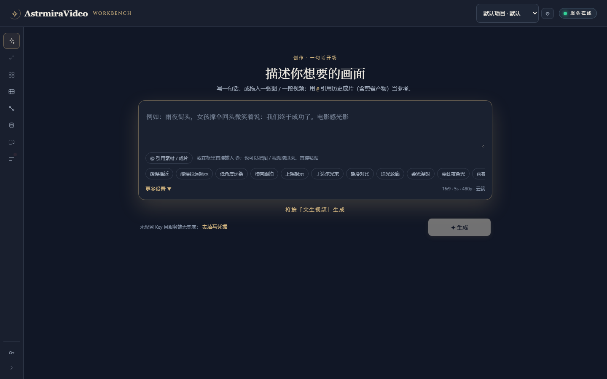
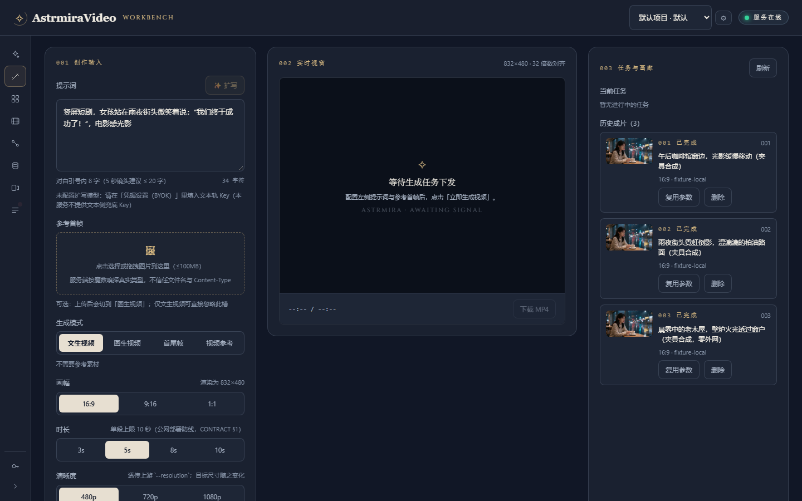
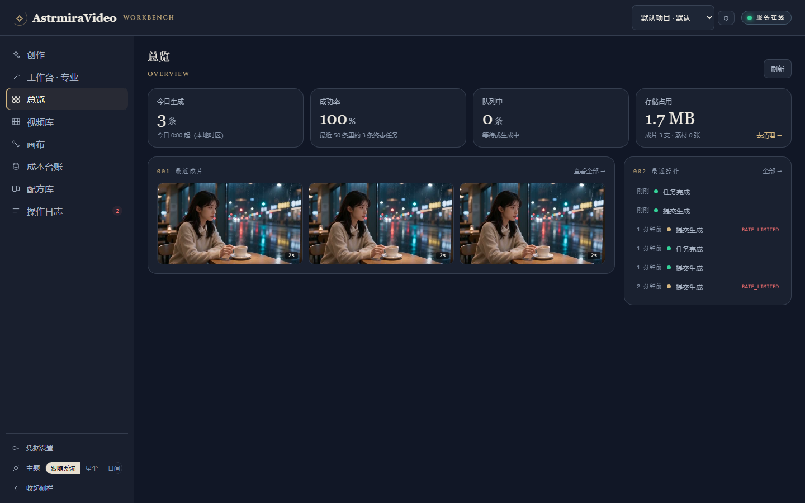
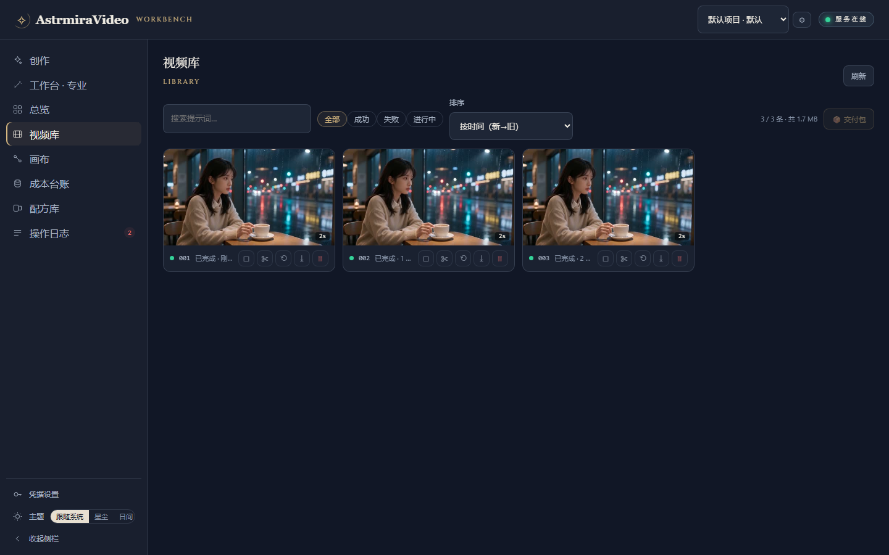
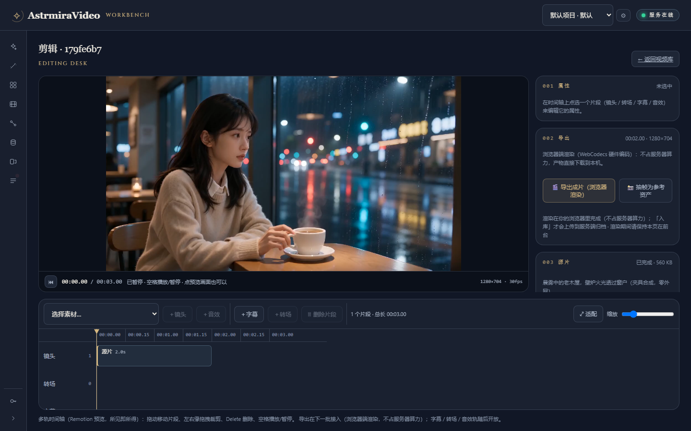
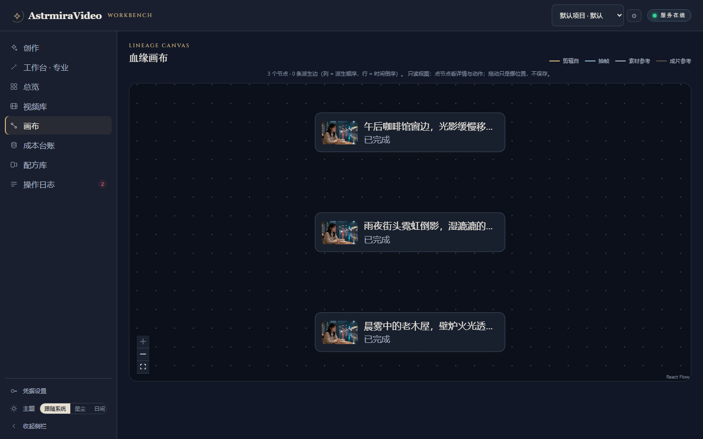
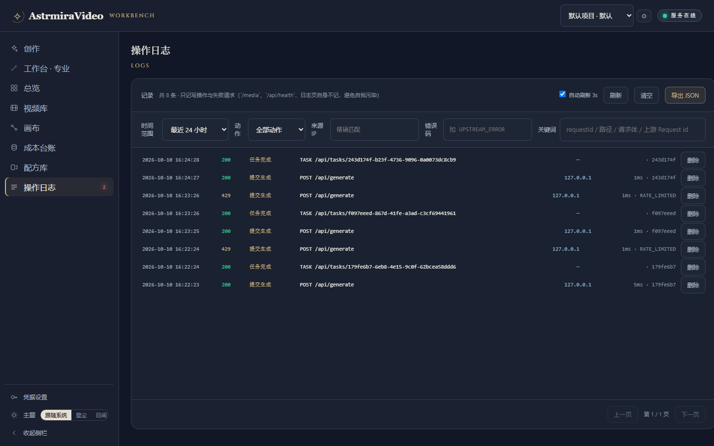

# AstrmiraVideo

> **自然语言描述 + 参考图/参考视频 → 本地/云端双轨 AI 视频生成工作台**（面向 B 端私有化部署）

**中文** | [English](README.en.md)

[](docs/PLAN.md)
[](LICENSE)
[](docs/PLAN.md)
[](docs/PLAN.md)
[](docs/CONTRACT.md)

> **当前进度、已完成项与未做项的唯一权威是 [docs/PLAN.md](docs/PLAN.md) §5 与 §9 台账** ——
> 本文不维护第二份状态描述（历史上正是因为 README 里写了一份"进度"，它最先过期）。

> **项目定位（如实）**：这是一个**面向"有私有化客户"的形态去写的学习向项目** ——
> 功能与防线按 B 端私有化交付的样子来写，但**当前没有真实客户**（也没有交付排期，见 PLAN §6-**D56**）。
> 版权与许可按**私人仓库 / 自己学习用**处理：[NOTICE](NOTICE) 保留为**事实登记**（事实不该因为
> "当下用不上"就删掉），但**不作为交付门槛**。

## 30 秒电梯陈述

输入自然语言描述、拖入参考图（首尾帧/风格）或参考视频，按**推荐配置与你自己的选择**路由到生成引擎
——**云端火山方舟 Seedance（BYOK 自备 Key，Key 只存在你自己的浏览器）**，或**你自己机器上的 ComfyUI**
（`host-comfyui`：引擎与模型都由你装，本仓只做接口适配；**可以配多台** —— 比如一台 3080 跑 480p、
一台 5090 跑 720p，界面上分别选，见 CONTRACT §19）。**H3 的模型也可以在 ComfyUI 里跑**。
在本地 ComfyUI 上还能**只凭一句话出图**（文生图 `t2i`）—— "出图"与"出片"**各有各的模板**，
同一台 ComfyUI 可以同时装视频模型与图片模型（契约 §19-3 的「模板清单」）。

> 本地轨此前还有「MiniMax H3」一档，**已在 V2.37 撤掉**（决策 **D56**）：它只有配置约定、
> 没有执行实现 —— 留着就是一个"**点了才知道不行**"的按钮。现在本地轨只有 ComfyUI 这一条路。

拿到成片之后，系统里还有一条**闭环**：**浏览器端剪辑台**（多轨时间轴 · Remotion 预览与导出 · 转场/字幕/音效轨/BGM 淡入淡出）
→ **渲染入库**（剪辑产物就是新素材）→ **血缘画布**（这条片子怎么长出来的）。
面向 B 端的运维与交付能力包括：**项目维度**、**成本台账（预估价 + 以方舟账单为准）**、
**交付包（多选导出 / 命名模板 / 平台规格转码 / 归档清单）**、**Webhook 终态回调**、
**可观测（live/ready 分级 + 指标快照 + 阈值告警）**、**备份与恢复（一致性快照 + 三道恢复闸门）**；
画布上还能**自己编排一条流水线并直接执行**（幂等提交 / 部分重跑 / 固定产物，编排可**导出成文件**带走）。

## 界面（真实截图，不是概念图）

> 下面的图由 `node scripts/capture-docs-shots.mjs` 在**本机生产形态**下截取（真服务 + 真任务 + 真渲染，
> 数据来自零成本的夹具链路）。**任何一张都可以自己复现** —— 这也是它们取代旧版 AI 概念图的原因：
> 概念图可以用来定方向，但**不能当产品说明**（旧图里出现的 ComfyUI/Kling 等名词本项目并不存在）。

| 创作入口（`#/create`，默认落地页） | 专业工作台（`#/workbench`） |
|---|---|
|  |  |
| 一句话 → 自动推断模式（文生/图生/首尾帧/视频参考）；`@` 可引用历史成片与素材 | 三栏控制台：提示词与素材槽 / 实时预览 / 任务与画廊 |

| 总览（`#/overview`） | 视频库（`#/library`） |
|---|---|
|  |  |
| 今日生成 / 成功率 / 队列 / 存储占用 + 最近成片与操作 feed | 筛选与排序、卡片操作、多选交付包 |

| 剪辑台（`#/edit?task=…`） | 画布（`#/canvas`：事实图 ↔ **编排** 两个模式） |
|---|---|
|  |  |
| 浏览器端合成与导出（WebCodecs，**不占服务端算力**），导出即可入库 | 事实图：节点 = 素材/任务，边 = 派生/抽帧/引用；**编排模式**：自己摆节点连线 → 一次提交（幂等、可部分重跑、可导出/导入编排文件）。<br>（上图是**事实图**模式，编排模式的截图待补） |



> **手机端现状（如实）**：当前是**"能看能点"的浏览态，不是剪辑终端** —— 时间轴、画布、
> 双栏检查器在 390px 下不可用（画布在窄屏**直接隐藏**）。三条手机截图与逐条证据见
> [docs/FRONTEND-REVIEW.md](docs/FRONTEND-REVIEW.md) §三，收口项登记在 PLAN §9 台账 **B60**。

## 快速开始

```bash
cp .env.example .env   # 按需填入火山 Key / 本地 ComfyUI 地址（多台见 GUIDE）
pnpm install
pnpm dev               # 并行拉起 backend + frontend（开发用，Vite 热更）

# 想在本机按**线上那份形态**验收（单进程托管 API + /media + 前端产物）：
pnpm build && pnpm serve:local   # → http://127.0.0.1:3000（加 --fixture 可零成本造验收数据）
pnpm smoke:ui                    # 真 Chrome 跑一遍生产形态的 UI 冒烟（含 CSP 与控制台零 error）
```

> **Node 版本**：**22 = 事实源**（`.nvmrc` + CI + 生产镜像三处同源；`engines` 要求 `>=22`）。
> 本机装 24 也能跑，但**别用更老的版本**（2026-10-08 发生过一次"本地绿、CI 红"的环境漂移）。
> 用 nvm 的话 `nvm use` 会读 `.nvmrc`。

填入自己的火山方舟 Key 即可出片（Key 存在**你的浏览器**，服务端过手不留存）；本地轨由**部署者显式启用**
（`EXPOSE_HOST_LOCAL_TRACK=1` + `COMFYUI_BASE_URL`；**多台**用 `COMFYUI_SERVERS_FILE`；
**文生图**另需装图片模型 + 一份图片模板，见 CONTRACT §19-3），
未启用时选择本地引擎会返回 `PROVIDER_UNAVAILABLE`。
**配完 env 重启后，用左栏「🔍 检测本地引擎」确认到底通不通** —— 它会**真的连一次**，并**逐台**报告
（一台连不上不影响另一台的结论）。推荐档位、多实例配置与引擎接入详见 [docs/GUIDE.md](docs/GUIDE.md)。

> **提示词扩写（✨）另需一把文本 Key**：与视频 Key 是**两套**凭据（可一键复用），在同一个「凭据设置（BYOK）」抽屉里填；
> 服务端**不设文本侧兜底 Key**（纯 BYOK），没填时按钮置灰并写明原因。
>
> **提交前先用「测试连接」**（凭据抽屉，**零费用**）：它会回答"Key 行不行 / 模型在不在 / 有没有开通"。
>
> **排错入口是侧栏「操作日志」**：记录"谁、何时、做了什么、结果如何"，报错时把那条记录的 `requestId`
> 发给开发者即可一条命中（细则见 GUIDE §七与 CONTRACT §10）。

## 技术选型与项目结构（一屏）

**不是 Ajax/jQuery，也不是"全家桶"**：前端 React 19 + Vite 6 + TypeScript（**自研 hash 路由**与
`useSyncExternalStore` store、**手写 CSS** + 设计 token），网络层是原生 `fetch` 且响应**一律过 zod 契约**；
后端 Fastify 5 + Node 22 + better-sqlite3（手写 SQL 与增量列迁移），**单进程**同时托管 API / 媒体 / 前端产物，
前面一个 Caddy 做 TLS 与登录。**两端共用 `packages/shared` 的 zod 契约**（Fastify 拿它当 validator，
前端拿它当响应断言）—— 这是本项目最重要的结构性选择。

```
AstrmiraVideo/
├── backend/src/       routes(15 域) · store(SQLite) · providers(上游) · queue(双轨调度)
│                      pipeline(防线与剪辑执行) · security(鉴权·凭据·限流·脱敏)
│                      webhook(终态回调) · ops(备份恢复 CLI) · observability(运维快照)
├── frontend/src/      views(8 个一级视图) · components · edit(Remotion 剪辑台)
│                      canvas(血缘画布) · lib(路由·api·凭据·项目·交付包) · styles(手写 CSS)
├── packages/shared/   前后端共用的 zod 契约（接口 / 错误码 / 剪辑工程 / 成本 / 命名…）
├── deploy/            compose + Caddyfile（域名档 / IP 档）；两容器：app + caddy
├── scripts/           冒烟 · 本地验收服务 · 夹具 · 部署 · **文档截图** · 基准
└── Dockerfile         单进程镜像（Node 22 + ffmpeg）
```

> **要不要换成更"成熟"的前端框架？结论：不换**，并写明了"什么条件下才该换"的四条可判定判据 ——
> 见 [docs/FRONTEND-REVIEW.md](docs/FRONTEND-REVIEW.md) §五（决策记录 PLAN §6-D46 / D47）。

## 能力边界（明确说了不做的事，和做了的一样重要）

| 不做 / 未做 | 现状与原因 |
|---|---|
| **本地轨的「MiniMax H3」档** | **已在 V2.37 撤掉**（决策 **D56**）：它只有配置约定、没有执行实现，留着就是一个"点了才知道不行"的按钮。本地轨**唯一形态 = `host-comfyui`**（自备 ComfyUI：已真机跑通，支持多台）；**H3 的模型可以在 ComfyUI 里跑**。（id 与 `/status` 的 `local` 段**保留**，只为兼容旧前端产物与历史请求体 —— 它们会得到 `503` 而不是被 schema 判成 `400`） |
| **多租户 / 跨租户隔离** | 决策 D42：交付形态是"一家客户一套私有部署"，隔离单位是**项目**而非租户 |
| **成员角色（管理员/创作者/查看者）** | 需要先有**用户身份系统**；没有登录就做角色只是"假门禁"（PLAN §9-B58） |
| **水印** | 决策 D45：不做（将来的"客户 logo 贴片"是另一件事，届时另立） |
| **手机端全功能** | 决策 D47：定位为**浏览态**（能看能点，不能剪）；5 项低成本收口见台账 B60 |
| **Prometheus 导出 / 告警外发通道** | 契约 §16 已写明：指标是 JSON 快照（外部 exporter 可转换）；告警只暴露"越线的事实" |
| **文生图（`t2i`）只走本地 ComfyUI** | 云端 Seedance 不做图片（选了会如实返回 `503`）；本地要装图片模型 + 对应模板（**内置一份**：FLUX.2 Klein distilled，装了模型即可用）。**图像编辑 / 多参考不在范围内**；编排模式里"把图片产物当首帧"也还没接（契约 §19-8） |

## 文档地图（每个知识点只有唯一所有者，其他地方只准链接）

| 文档 | 职责 | 独家拥有的内容 |
|---|---|---|
| **README.md**（本文） | 入口与导航（中文） | 电梯陈述、界面截图、技术选型速览、文档地图、协作规范 |
| [README.en.md](README.en.md) | 入口与导航（**英文**） | 上述内容的英文版；**口径以中文文档为准**（英文版是给非中文读者的入口） |
| **[NOTICE](NOTICE)** | **第三方许可说明** | 直接依赖的许可证清单、**Remotion 的 source-available 边界（B 端交付前必看）**、外部工具（ffmpeg / ComfyUI）与服务条款边界 |
| [docs/PLAN.md](docs/PLAN.md) | 产品与开发规划 | 架构、功能清单、**七道防线**、**Step+AC**、**进度日志（§5，唯一权威）**、决策记录、安全合规、成本风险、**台账 §9** |
| [docs/CREATION-EXPERIENCE-DESIGN.md](docs/CREATION-EXPERIENCE-DESIGN.md) | 创作体验设计基准 | 新版交互规则、视觉图、可点击稿、模型未配置状态、即梦观察证据；实施与进度仍见 PLAN |
| [docs/CONTRACT.md](docs/CONTRACT.md) | 接口唯一权威 | TS 类型、**路由表**、错误码字典、存储与资产生命周期、备份与恢复契约 |
| [docs/GUIDE.md](docs/GUIDE.md) | 上手指南与运维手册 | Tier 0~3 算力矩阵、双轨引擎接入、四种工作流、FAQ、**运维巡检与备份恢复 SOP** |
| [docs/FRONTEND-REVIEW.md](docs/FRONTEND-REVIEW.md) | **前端框架与适配性复盘** | 技术选型逐层点名、"要不要换框架"的判据、移动端适配体检（含复现命令） |
| [docs/N8N-REFERENCE.md](docs/N8N-REFERENCE.md) | **n8n 设计借鉴清单** | 逐条借鉴项（画布交互 / 产品语义 / 工程交付）→ 台账编号映射、落地顺序、**明确不借鉴的**、参考方式与许可证边界 |
| [docs/PENDING-DECISIONS.md](docs/PENDING-DECISIONS.md) | **待拍板清单** | 只有产品负责人能定的开放项（选项 / 推荐 / 卡住了什么）+ 需追认的已定项 + 按条件排期的技术债 |
| [docs/UPSTREAM.md](docs/UPSTREAM.md) | 上游台账 | 参考/复刻项目与版本追溯（含 ffmpeg 等外部工具的来源 / 版本 / 许可证登记） |
| [docs/walkthrough.md](docs/walkthrough.md) | Step 4 验收记录 | AC1~AC4 的逐条证据——**只放证据，不放状态** |
| [docs/v9-acceptance.md](docs/v9-acceptance.md) | Step 6（V9）验收记录 | AC1~AC8 的逐条证据、门禁基线、遗留与如实说明 |
| [docs/edit-desk-acceptance.md](docs/edit-desk-acceptance.md) | Step 7（剪辑台改版 / B34）验收记录 | AC1~AC8 的逐条证据、修掉的真缺陷清单、能力边界与遗留台账 |
| [docs/step8-10-acceptance.md](docs/step8-10-acceptance.md) | **Step 8~10 验收清单** | 逐条「点哪里 → 看什么 → 期望」+ 谁跑 + **明确没做与做不到的** |
| [docs/sample-lemi-plan.md](docs/sample-lemi-plan.md) | 样片（B56）执行卡 | 分镜 / 提示词要点 / 预算 / 过程记录表 |
| [docs/EXEC-V9.md](docs/EXEC-V9.md) · [docs/EXEC-STEP8.md](docs/EXEC-STEP8.md) | 施工手册（**一次性**） | 验收走完后**归档删除**，有效口径逐处迁入 PLAN（见 PLAN §5） |
| [NEXT_SESSION_PROMPT.md](NEXT_SESSION_PROMPT.md) | 跨会话接力 | 纯指针，不含任何独家信息 |

## 协作与文档规范（所有贡献者与 AI 会话必须遵守）

1. **脱敏红线**：IP / 绝对路径 / 凭证永不写入 md，一律 `<占位符>`，真实值只存本地 `.env`（模板：`.env.example`）；
2. **单一事实源**：每个知识点只在 Owner 文档详写一次，引用处只放链接；禁止跨文档复制段落；
3. **每步必带 AC**：任何实施步骤必须附可测试的验收标准与验证方式，否则视为未定义；
4. **一致性自检**：修改方向性结论后，必须全仓检索相关关键词并同步所有受影响文档；
5. **三级标记**：**【已验证】**实测确认 / **【待验证】**未经实测 / **【规划】**尚不存在——未标注的事实性数字视为【待验证】；
6. **进度回检**：任何 Step 状态变更（开工 / 完工 / 阻塞）必须在**同一提交**内回检三处指针——README 徽章与「快速开始」段、PLAN §5 进度日志、NEXT_SESSION_PROMPT 指针段。三处只准链接 PLAN §5，禁止出现第二份状态描述。

> 以下四条**原施工手册 §3「铁律」的存档**（2026-09-23 迁入；违反即返工）。

7. **契约先行**：`docs/CONTRACT.md` 是接口唯一权威，**变更需先改文档再改代码**（类型 / 路由 / 错误码 / 存储契约都只在那一处详写）；
8. **探针不替访客下结论**：`/api/providers/status` 不得返回任何未经显式配置的硬件信息，不得硬编码型号，`reason` 文案不得出现"你的设备 / 你没有显卡"这类对访问者的判断（细则见 PLAN §4 Step 2-AC6 与 §6-D22 / D27）；
9. **Key 零留存**：凭据只走请求头（`X-Provider-Key` / `X-LLM-Key`），**不落库、不写日志、不回显明文**；pino `redact` 与 CORS `allowedHeaders` 必须就位（漏任一项，云端轨在真实浏览器上直接不可用或明文泄露）；
10. **不静默降级**：能力未实现就返回明确错误码（如 `LLM_NOT_CONFIGURED`、`PROVIDER_UNAVAILABLE`），**不许假装可用、不许规则引擎冒充 AI**，也不许"用户填了配置却不生效"（见 PLAN §6-D30 / D31）。

> 另外两条**施工流程纪律**（原手册 §10 / §11 的存档）：**每片完工必交证据**（AC 逐条 → 命令 → 输出摘录 → 判定；不许用"应该/大概"描述结果）；**提交粒度**为"一片一提交、不合并跨片提交"，消息用 conventional commits，提交前自检 `pnpm lint && pnpm type && pnpm test:contract && pnpm test:coverage` 全绿 + `pnpm build` + `pnpm smoke:ui`。

## License

本仓自身是 **[MIT](LICENSE)**。

> **口径（2026-10-15 明确）**：本项目按**私人仓库 / 自己学习用**维护（见上方"项目定位"与 PLAN §6-**D56**）。
> 下面的两条**不是交付门槛**，而是"**将来真要对外分发时该看的东西**"——
> 它们仍然留在 [NOTICE](NOTICE) 里，是因为**事实不该因为"当下用不上"就被删掉**。

**第三方依赖里有两条必须单独看**（详见 **[NOTICE](NOTICE)**）：

1. **剪辑台用的 Remotion 是 source-available 许可，不是 OSI 开源** —— 不在它免费范围内的组织
   （个人与小团队之外），**商业交付前需自行取得 Remotion 的商业许可**；这一点出现在这里，
   是因为它属于"B 端交付必须先知道的事"，而不是依赖树里的小字。
2. 外部工具（**ffmpeg**、用户自备的 **ComfyUI**、云端方舟账号）各有其条款与许可，
   由**部署者 / 使用者**自己确认。

第三方模型与云端 API 的服务条款边界另见 docs/PLAN.md §7。
