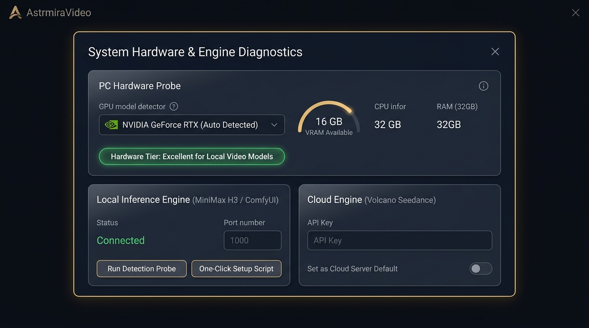
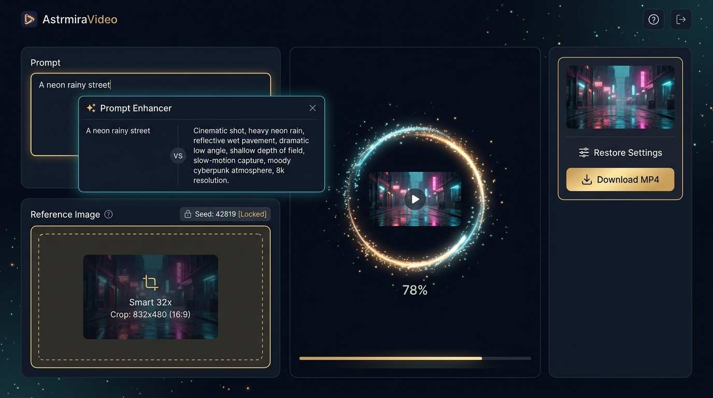

# AstrmiraVideo · 上手指南（GUIDE）

> 打通"自然语言描述 + 参考图/参考视频 → 本地/云端 AI 生成视频"的完整工作流。
> 标记约定：**【已验证】**实测确认 / **【待验证】**未经实测 / **【规划】**尚不存在。
> 防线机制、进度与决策以 [PLAN.md](PLAN.md) 为准；接口细节以 [CONTRACT.md](CONTRACT.md) 为准，本文不重复。

---

## 目录
- [（一）硬件探测与算力分级（Tier 0~3）](#一硬件探测与算力分级tier-03)
- [（二）双轨引擎接入](#二双轨引擎接入)
- [（三）四种生成工作流](#三四种生成工作流)
- [（四）四项体验功能](#四四项体验功能)
- [（五）界面导览](#五界面导览)
- [（六）FAQ 与避坑](#六faq-与避坑)
- [（七）操作日志](#七操作日志v21)

---

## （一）推荐档位与本地引擎配置（Tier 0~3）

> **本节是档位文案的唯一详写处**：前端展示的推荐说明为其投影，改则同步（台账 PLAN §9-B6）。

下表是**选型建议**，**不是探测结论**——系统不扫描你的硬件，也**不替你判断设备能力**（决策见 PLAN §6-D22）。`GET /api/providers/status` 只报告**本服务自身**的本地引擎配置状态：env 有没有兜底 Key、本地引擎有没有被部署者显式启用。

| 推荐档位 | 硬件特征（显存） | 本地可部署评估 | 建议 |
| :--- | :--- | :--- | :--- |
| **Tier 0**（无独显/核显） | 无独立显卡 或 < 6GB | 无法运行视频 DiT 模型（必 OOM） | 推荐【云端 Seedance】；本地开关**保持可选、不置灰**——选了但服务端未配置本地引擎时会返回 `PROVIDER_UNAVAILABLE` |
| **Tier 1**（入门档） | 6~10GB | 轻量量化模型（LTX-Video / CogVideoX-2B / Wan2.1 1.3B）【待验证】 | 日常小样；重要成片切云端 |
| **Tier 2**（主力档） | 12~16GB | **在 ComfyUI 里跑**量化视频模型（内置模板 Wan2.2 TI2V-5B + fp8，10GB 卡实测 5s/480p ≈ 166s【已验证】）；MiniMax H3 NF4（Disk Offload）在独立环境里单步约 8~14 分钟【历史实测】 | 本地离线主力，0 Token 成本（慢）；实时出片推荐云端。**⚠️ H3 那一档我们的 provider 已撤（D56）—— 要把 H3 用起来，请把它的模型装进 ComfyUI，走 `host-comfyui`** |
| **Tier 3**（旗舰档） | ≥ 24GB | 全精度/高分辨率/复杂工作流【待验证】 | 极速本地生产 |

**双轨姿态**：默认走云端；本地轨需**部署者显式配置启用**（服务端 `.env` 的 `EXPOSE_HOST_LOCAL_TRACK=1` + `COMFYUI_BASE_URL`；**多台**再加 `COMFYUI_SERVERS_FILE`，见（二）轨道 A）。未启用时能力位如实说明是「本服务未配置本地引擎」还是「本服务未向访客开放本地轨」——**不会说"你的设备不支持"**（`GET /api/providers/status` 只陈述**本服务自身**的配置事实）。



---

## （二）双轨引擎接入

### 轨道 A：本地模型推理（两种路径）

**当前可用于生产的本地路径：`host-comfyui`（接入你自己装好的 ComfyUI）【已实现，且真机跑通】**

引擎与模型**都由你决定**，我们只做接口适配（CONTRACT §19；决策 D53）。三步：

1. **配 env**（服务端 `.env`，改完**重启**）：
   - **单台**：`EXPOSE_HOST_LOCAL_TRACK=1` + `COMFYUI_BASE_URL=http://127.0.0.1:8188`；
   - **多台**（例如一台 3080 跑 480p、一台 5090 跑 720p）：再加
     `COMFYUI_SERVERS_FILE=<一份 JSON 的路径>`，形如
     ```json
     [
       { "name": "office", "label": "办公室的 3080", "url": "http://127.0.0.1:8188", "template": "wan22-ti2v-5b", "maxPixels": 921600 },
       { "name": "home",   "label": "家里的 5090",   "url": "http://192.168.1.20:8188", "fps": 24 }
     ]
     ```
     每台得到自己的引擎档位（`host-comfyui:office`），界面里**分别选**（按钮上带实例名）。
     实例里的 `template` 与档位（`maxPixels` / `steps` / `cfg` / `shift` / `fps` / `dtype`）
     **逐项覆盖**全局 env —— 优先级 **实例 > 全局 env > 内置默认**（一台机器一个显存档）；
     地址只允许**回环或内网**（`isAllowedEngineUrl`，防 SSRF），**不允许请求体指定地址**；
   - 模型放进 ComfyUI 的 `models/`；工作流模板可用 `COMFYUI_TEMPLATE_DIR` + `COMFYUI_TEMPLATE`
     换成你自己的（ComfyUI 里「另存为 API 格式」导出的 `<name>.api.json`）—— **换模型不必改我们的代码**；
2. **重启后，在左栏点「🔍 检测本地引擎」**：它会**真的连一次**（拉 `/object_info`，通常一两秒），
   **逐台**报告"连不连得上、模型与节点齐不齐、能跑哪些模式"。
   ⚠️ 在这一步之前，**没有任何界面**能回答"我配好没有" —— 靠提交任务去试错，失败原因会和
   提示词 / 素材 / 额度混在一起（见 CONTRACT §20 与 §2 的分工）；
3. 界面上选那一台并提交。提交时若缺模型或节点，错误里会**点名缺哪个**（不糊在一句"提交失败"里）。

**路径 2（历史规划，仍未做）**：一键部署脚本（检查 Python / Git → 建 venv → 装 PyTorch → 拉权重）。
**现在不推荐**这条路：引擎与模型由你自己装是 D53 的取向（我们不内置模型、也不替你选模型）。

> ⚠️ **关于 `local-minimax-h3` 那一档（V2.37 起已撤掉，决策 D56）**：
> 它**只有配置约定、没有执行实现** —— 用户 2026-10-15 拍板撤掉（界面不再提供、`/status` 不再宣称可用、
> `/selfcheck` 不再检测）。撤掉的正是一个"**点了才知道不行**"的按钮（本仓最反感的那种形态）。
> 现在本地轨**只有 ComfyUI 这一条路**；**H3 的模型可以在 ComfyUI 里跑** ——
> 这也正是当前满足"数据不出域"的方式，走上面那条路即可。
> （`local-minimax-h3` 这个 id 与 `/status` 的 `local` 段**仍保留**，只为兼容旧前端产物与历史请求体：
> 它们会得到 `503`（人话），而不是被 schema 判成 `400`。)

### 轨道 B：云端商业 API（火山方舟 · Seedance）

1. 登录[火山引擎控制台](https://www.volcengine.com/) → 火山方舟（ModelArk）→ 开通视频生成服务，生成 API Key；
2. 前端设置抽屉填入 Key，或配置 `.env`（键名见根目录 `.env.example`）；
3. 安全机制：Key 存于**你的浏览器**（默认 `sessionStorage`，关闭标签页即清除；可选 `localStorage`，表示你接受**明文存储**风险），随请求头 `X-Provider-Key` 发送；服务端只在转发瞬间**过手**，**不落盘、不写日志、不回显**（细则见 PLAN §7-1 与 CONTRACT §5「凭据传递约定」）。

---

## （三）四种生成工作流



1. **T2V 文生视频（含台词人声）**：输入主体与动作描述即可。⚠️ 下面这条是 **H3 模型侧**的知识（我们这一侧的 `local-minimax-h3` 档尚未实现 —— 见（二）轨道 A；走 ComfyUI 跑 H3 时，音频行为取决于你那套节点图）：对白用**直角双引号**包裹（`女孩说："快看，流星！"`），H3 输出 MP4 直接合成立体声台词与环境音【已验证：在 H3 环境里】；
2. **I2V 首帧图生视频**：拖入单张图作起始帧 + 运动指令。Smart Crop 自动居中裁切并规整为 32 的整数倍（如 832x480），避免 DiT 尺寸报错。⚠️ **素材要避开"拟真人脸"**：上游会对输入图做隐私检测并直接拒绝（见 §六 Q10）；
3. **FL2V 首尾帧过渡【前端已支持；上游接受度待真实冒烟核对】**：左栏切「首尾帧」→ 分别上传首帧与尾帧 + 转场描述，由模型补出中间运动；
4. **V2V 参考视频重绘【形态已验证（2026-09-23）；需要 `PUBLIC_BASE_URL`】**：左栏切「视频参考」→ 上传参考视频（mp4 / mov）+ 风格提示词。上游把它当**另一种元素**处理（`video_url` + 角色 `reference_video`），并**只接受上游能抓的公网地址、不接受内联 data URL**（原文：`reference_video must be provided as a web url`）。因此：
   - **公网部署**（配了 `PUBLIC_BASE_URL`，且反代对 `/media/assets/*` 放行）→ 正常可用；
   - **本地 / 内网部署**（没有公网基址）→ 提交时**直接返回 `INVALID_ASSET`** 并提示去配 `PUBLIC_BASE_URL`，**不会**发一个注定被上游拒绝的请求（这条守卫是拿三次真实探测换来的）；
   - 参考**图片**不受此限制（图片可以走 data URL，已实测）。
   概念区分：**FL2V（首尾帧）** 已实测可用且效果好（0.1s 起于首帧、末帧与给定尾帧几乎一致）；**V2V** 是"用参考视频的运镜/风格重绘"，两者不要混。

---

## （四）四项体验功能

1. **✨ 提示词扩写【已实现，CONTRACT V2.0】**：`雨夜街道` → `电影质感画面，霓虹灯光映照湿滑路面，低机位微仰拍，浅景深，慢动作`。语义为「**未配置文本 Key 时按钮置灰并写明原因、配置后可用**」；
   - **纯 BYOK**：Key 由用户自带，服务端**不设兜底 Key**（因此状态端点的 `llm.available` 恒为 `false`，判断"能不能用"请看你本地填没填，别读那个字段）；
   - **怎么配**：左栏「凭据设置（BYOK）」→「扩写模型（文本轨）」段选预设（OpenAI / DeepSeek / 火山方舟）或「自定义」填 `baseUrl` + 模型名，再填 Key。预设里的**模型 id 只是占位**，各家发布节奏不同、且必须与你账号的可用列表匹配 —— 报 `401 KEY_INVALID` 或上游 404 时先核这一项；
   - **失败怎么读**：`LLM_NOT_CONFIGURED`（没填 Key / 自定义没填全）、`KEY_INVALID`（Key 被上游拒绝）、`UPSTREAM_ERROR`（上游故障或超时，可重试）；三者文案不同，**不要**把 `UPSTREAM_ERROR` 当"没配"；
2. **📐 裁切预览**：上传参考图后实时按**目标画幅**显示裁切区域（`cover` 裁切）+ 32 倍数目标尺寸数字；
   - **模型档位（V2.1）**：视频轨的模型从"手打文本框"改为**档位下拉 + 自定义**：`doubao-seedance-2-0-mini-260615`（默认，省钱档）/ `1-0-pro-fast-251015`（省钱档）/ `1-0-pro-250528`（标准）/ `2-0-fast` / `2-0` / `2-5`（画质）。清单与价格说明见 `packages/shared/src/videoModels.ts`，**可用性按账号**（方舟需先开通模型服务），拿不准就点「测试连接」。⚠️ 历史教训：手打模型名曾直接导致线上 404（见 §六 Q9）；
3. **🎲 种子锁定 / 重抽**：**锁定已实现**（锁 Seed 精确对比运镜）；**"重抽"未实现**——未锁定时靠"不传 seed"由服务商随机，没有骰子按钮（V8.3 批次 1 与参数控件一起补）；
4. **📜 参数一键回填**：画廊点【复用参数】，提示词/模式/画幅/引擎/种子/资产完整还原；
5. **🧪 测试连接（V2.1）**：凭据抽屉里两条轨各有一个按钮，**提交前零费用**回答"Key 行不行 / 模型在不在 / 有没有开通"；
6. **📋 操作日志（V2.1）**：顶栏「日志」—— 谁、何时、做了什么、结果如何（细节见 §七）。

---

## （五）界面导览

Astrmira 星尘设计系统（深墨蓝底、微光金点缀、毛玻璃卡片、呼吸动效），**两套主题**：暗色 = 星尘内核（按参考图略微提亮后的 `#111726` 底），日间 = 现代简洁·蔚蓝（`#f4f7fb` 底 + `#2f6fe0` 主色）。**默认跟随系统**，主题开关在**侧栏底部**可手动切「跟随系统 / 星尘 / 日间」，选择记在本机；两套主题的对比度都有静态断言兜底（见 PLAN §6-D29）。

**导航结构（V9 起；B41 起默认视图 = 创作）**：顶栏只留「品牌 + 服务在线状态」；左侧栏可收展（展开 240px / 收起 56px 图标栏，状态记在本机），一级视图六项 —— 另有一个**不进侧栏**的剪辑台（它需要源片上下文才有意义）：

| 视图 | 路径 | 用途 |
| :--- | :--- | :--- |
| **创作** | `#/create` | **默认视图（Step 8 · B41 起）**。一句话 + `@` 素材 → 生成；支持拖图/粘贴直传、配方 chips、更多设置收起。详见下方「创作入口怎么用」 |
| 生成工作台 | `#/workbench` | **专业模式**（B41 起不再是默认落地页，能力与三栏布局原样保留）。进入该视图时侧栏**默认收起**（可手动固定） |
| 总览 | `#/overview` | 今日生成 / 成功率 / 队列中 / 存储占用四卡（数字与 `/api/history`、`/api/logs` **逐一对账**）+ 最近成片九宫格 + 最近操作 feed；「去清理 →」直达视频库并按体积排序 |
| 视频库 | `#/library` | 搜索（提示词模糊）/ 筛选（成功·失败·进行中）/ 排序（时间双向、体积降序）；卡片四个动作 ✂ ⟲ ⤓ 🗑；右侧详情抽屉（完整参数 + 复用 / 剪辑 / 下载 / 删除 + **本片剪辑历史**）。**成片可能"已清理"**：`outputs/` 超过容量阈值时服务端会从**最旧的已成功任务**开始自动删除成片文件（任务记录与血缘保留，卡片会显示成片已清理）——见下方 FAQ |
| **画布** | `#/canvas` | **同一张画布的两个模式**：**事实图**（"这条成片是怎么长出来的"：生成 / 抽帧 / 剪辑 / 参考关系成一张 DAG）与**编排**（`?mode=plan`：自己摆节点连线 → 一次提交，可部分重跑 / 固定产物 / 导出导入编排文件）。详见下方「画布怎么用」 |
| 配方库 | `#/recipes` | 20 张提示词配方卡（运镜 / 光线 / 氛围 / 节奏）。两个入口：「插入骨架到提示词」（**逐字追加**到末尾）与「仅作扩写上下文」（不动提示词，只在 ✨ 扩写时把配方注入 system prompt） |
| 操作日志 | `#/logs` | 一级视图（不再是弹层）；有失败请求时侧栏项带红点；可导出当前筛选为 JSON |
| 剪辑台 | `#/edit?task=<id>` | **不进侧栏**，从视频库卡片的 ✂ 进入。**Remotion 多轨时间轴**（镜头 / 转场 / 字幕 / 音效四轨）+ 实时预览 + 右侧属性面板 + 导出；**渲染在你的浏览器完成（服务器零算力）、零上游调用**（不花钱、不占冷却）。详见下方「剪辑台怎么用」 |

**生成工作台视图内的三栏**：

- **左栏控制区**：Prompt、✨扩写、**参考素材槽（按模式出现：首帧 / 尾帧 / 参考视频；带裁切指示）**、**生成模式（文生 / 图生 / 首尾帧 / 视频参考）**、画幅、**时长（3/5/8/10s）与清晰度档（480p/720p/1080p——目标尺寸 = 画幅 × 档位）**、Seed 锁、引擎切换、**凭据设置（BYOK：视频轨 + 文本轨两套）**；
- **中央视窗**：生成进度（粒子环 + 百分比）、成片播放器、MP4 下载；
- **右栏画廊**：任务队列与历史成片（卡片封面用服务端抽好的**首帧 JPEG**，由 `` 渲染，不再挂 50 个 `<video>`；旧记录或抽帧失败的任务回落为 `<video>` —— 见 PLAN §5 的 V8.3 批次 3-④）。
  - **点封面即可在中栏播放**（V8.3 批次 7）：可播的卡片封面是个按钮（角标 ▶ 现在是**真的**入口），点一下就把那条任务载入中栏播放器，当前正在看的那张卡有主色描边；没有成片的卡片（未完成 / 失败 / 成片已清理）保持不可点，并给出原因提示。
  - **两套主题下放映区都可读**（同批次）：放映区底色在两套主题里都是深色，因此区内的文字用独立的 `--canvas-*` 一组 token —— 此前日间模式是"深底 + 深字"，看不到提示。

**移动端（≤768px）**：侧栏退化为**汉堡唤出的 overlay 抽屉**（点导航项自动收起）；工作台三栏**纵向堆叠**（控制区在前）；画廊与九宫格**单列**；详情抽屉**全屏**。

**动效（V9）**：视图切换淡入上移、卡片 40ms 级联、生成中播放器呼吸微光晕、出片时星尘在画面中央**绽放一次**、卡片 hover 浮起 2px + 金描边、加载骨架扫光。`prefers-reduced-motion: reduce` 下**全部归零** —— 这一条由 UI 冒烟的**双 context 对照**验证（同一产物在 reduce 档 `1e-05s`、normal 档 `0.26s`），而不是"应该会"。

### 创作入口怎么用（Step 8 · B41 起：默认落地页「造梦盒」）

一句话说明你要的画面，需要参考就 `@` 一下 —— 其余的自动推断，高级项收在「更多设置」里（默认不打扰）：

1. **写一句话**（回车 = 提交，Shift+回车 = 换行）；
2. **引素材**：点「＠ 引用素材 / 成片」或直接在框里打 `@` —— 弹层里可选**以前的成片 / 剪辑产物**（可当视频参考）与**上传过的图片 / 视频**；也可以把图/视频**拖进来或直接粘贴**（拖入即上传，落为参考资产）。选中的素材显示为 **chips**（可逐个删除）；
3. **模式由素材决定**（与专业模式同一纪律）：0 素材 = 文生视频；1 张图 = 图生视频（首帧）；2 张图 = 首尾帧；含视频 = 视频参考（只用第一个视频）。摘要行会**说出**将按哪个模式生成，被忽略的多余素材也会**明说原因**，不静默；
4. **配方 chips**：点一下把该配方的骨架**逐字追加**进输入框（与配方库同一份数据）；
5. **更多设置**：画幅 / 时长 / 清晰度 / 引擎 / seed —— 默认收起，右下角一行摘要可见当前选择；
6. **提交后不跳页**：下方内联出现任务卡（进度条 → 成片播放器 → 下载 / 送剪辑台 / 再来一条）；想用完整专业界面就点「去专业模式查看」。

> 为什么这么设计：默认页追求"一句话开场"的沉浸感，把控件**分层**而不是删掉 —— 专业模式的能力一个不少。

> **V2.9 起的两个体验补强**：
> ① **弹层按文件名认素材**（B43）：新上传的资产会记住**原始文件名**（只存在**你的服务器本地**，
> 不进上游、不进日志），弹层与 chips 直接显示名字，也可以按名字搜（assetId 仍可搜）——
> V2.9 之前上传的老资产与剪辑台抽出的帧没有文件名，仍按编号显示，**不会编造名字**。
> ② **真人素材的前置提示**（B32）：含真人 / 拟真人脸的图做首帧·尾帧会被上游**隐私检测**拒绝。
> 槽位下方会给出提示（**只是引导，不阻断、也不做本地人脸识别**）；真被拒时，任务卡上的失败原因
> 会给出可执行动作（换非人物素材 / 改用文字描述人物 / 有本地显卡可走本地轨），并说明这次**没有产生成片费用**。

### 画布怎么用（同一张画布的**两个模式**）

模式记在 URL 上（`#/canvas` 与 `#/canvas?mode=plan`）—— 刷新与分享都会落回同一个模式。

**① 事实图（`#/canvas`）—— "这条成片是怎么长出来的"**

每个成片 / 剪辑产物 / 参考资产是一个节点，它们之间的派生关系是边（四种：**剪辑自 / 抽帧 / 素材参考 / 成片参考**）：

- **布局**：列 = 派生顺序（一代一代向右），行 = 同列内新的在上。拖动节点只是挪位置（不保存）；
- **点节点**：右侧弹出详情 —— 成片节点可 **⟲ 复用参数 / ✂ 送剪辑台 / 🎬 设为视频参考（直接进工作台的参考视频槽）**；
  图片资产可 **当作首帧（I2V）**；已删除或超出最近列表的对象显示为**虚线 ghost 节点**（血缘不会断）；
- **这张视图是只读的**：不能连线、不能删节点 —— 它回答"**已经发生了什么**"；
  要"**打算做什么**"用编排模式（下面）；
- **规模**：首屏取最近一页（50 条生成 + 50 条剪辑产物），工具条「⏮ 加载更早」按页往前翻，
  翻完**置灰并写明「已全部加载」**；节点多时只为**视口内**的节点建 DOM（见 PLAN §9-B44）；
- 窄屏（手机）会如实提示去桌面端看 —— 不硬塞一个缩略画布。

**② 编排（`#/canvas?mode=plan`）—— "我打算让机器做什么"**

自己摆节点、连线，然后**一次提交**（一张图 = 一次可运行的编排，CONTRACT §11-6）：

- **＋ 节点** → 右侧面板写提示词 / 选模式（文生 / 视频参考）/ 画幅 / 时长 / seed；**拖句柄连线**表示数据流
  （只有 v2v 能接上游；连线错的三类情况会被当场拒绝）；
- **▶ 运行编排**：按**依赖顺序**提交；**同一编排重复点不会重复计费**（幂等键是确定的：
  `plan:<编排 id>:<节点 id>[:r<代数>]`）；
- **🔁 重跑**（工具条 = 整张图；节点面板 = **这一段及其全部下游**）：它**换一代幂等键 → 真的新建任务（真的计费）**。
  只改了某一段就用节点面板那一个 —— **上游沿用上次产物，这是最省钱的入口**；
- **📌 固定（Pin）**：钉住"很贵 / 已经满意"的那一段，**之后任何运行（含「重跑全部」）都不再动它**，
  下游一律引用它；固定产物在运行前会照样校验（被容量淘汰的成片不能当引用）；
- **失败重试**：只对 **5xx / 网络层**重试；**4xx 与 429（冷却）不重试**（后者是"等一下再点"）；
  重试**沿用同一个幂等键** —— 不会因此多花一次钱；
- **⤓ 导出编排 / ⤒ 导入编排**：把这份编排存成一个 JSON 文件带走（给同事 / 另一台部署 / 留档）。
  文件**不含凭据**，并把"不含什么"写在里面；导入得到的是**一份新的编排身份**（首次运行会新建任务），
  当前编排非空时**先让你确认**（不静默覆盖）；坏文件会**说清哪里不对**且**当前编排一动不动**（CONTRACT §11-6 附）；
- **存在哪**：编排存**你自己的浏览器**里（按项目隔离），不上传服务端。

### 剪辑台怎么用（Step 7 起：Remotion 多轨）

**四轨**：镜头（视频片段）/ 转场 / 字幕 / 音效。时间轴上的片段可**拖动**（自动吸附 0 点、播放头与邻居首尾）、
**左右缘拖拽裁剪**、点击选中（Delete 删除、空格播放/暂停）；**右侧属性面板**按选中片段的类型显示可调参数
（镜头：标签/变速/音量；字幕：文本/位置/动效；转场：类型/时长；音效：音量），改完**预览立即跟随**。

三个高频动作：

1. **加转场**：选中一个镜头 → 点「＋转场」→ 它会和后一段"接起来"（后一段整体左移，重叠区就是转场窗口：
   淡入淡出 / 左揭幕 / 右滑入）。**注意**：移动、裁剪或删除转场两端的任一片段都会**移除该转场**并把片段还原
   （界面会提示，不会悄悄改）；转场时长可在属性面板改。
2. **加字幕**：点「＋字幕」在播放头处加一条（默认 2s），在属性面板改文本、位置（底/中/顶）与**动效预设**
   （静态 / 淡入淡出 / 逐词入场 / 打字机）。
3. **导出**：点「🎬 导出成片」——**用你浏览器的硬件编码渲染**（与预览同一套合成，所见即所得），
   渲染期间请保持页面在前台；完成后可「⤓ 下载 MP4」。想把成片留到服务端（出现在「本片剪辑历史」、
   可继续编辑、可抽帧）就点「📥 入库」（**上限 100MB**，与反代请求体上限同口径）。

**抽帧 → 再生成（闭环）**：把播放头停在想要的画面上 → 点「📸 抽帧为参考资产」——
它会**按当前画面（含字幕/转场）**渲染一张 PNG 上传为参考资产，并自动跳到生成工作台：
**模式已切到「图生视频」、首帧槽已填好**，补一句运动描述就能继续生成。

**编辑不会丢**：剪辑台按源片在本机存草稿（刷新/切视图后自动恢复）。**服务端不参与编辑态**，
只有你点「入库」时才上传产物与工程。

---

## （六）FAQ 与避坑

> **排错第一站是顶栏「日志」**（V2.1）：它记录"谁、何时、做了什么、结果如何"，
> 报错时把界面上那条记录的 `requestId` 发给开发者即可一条命中（服务端同时把它回写在响应头 `x-request-id`）。
> 日志页支持按时间 / IP / 动作 / 错误码 / 关键词筛选，展开能看到请求体与上游 `Request id`。

**Q0：我的成片"消失"了？**
两种可能，都不算丢失数据：① **手动删除**（视频库卡片的 🗑，删除任务记录并释放磁盘）；② **容量淘汰**——
`outputs/` 超过阈值（默认 4GiB，部署者可用 `OUTPUTS_MAX_BYTES` 调）时，服务端会从**最旧的已成功任务**开始
删成片与封面文件，**任务记录与血缘保留**（视频库显示"成片已清理"、画布显示 ghost）。
保护规则：正在跑的任务、被当作 `task:` 参考引用的成片、以及参考资产（上传的图/视频）都不参与淘汰。
每次淘汰都会在**操作日志**里留一条 `storage.evict`（含释放字节数与被淘汰的任务 id）。

**Q1：提示词写了对白，视频却没声音？**
H3 只识别直角双引号 `"` 包裹的对白；中文引号 `“”` 或无引号会被当作普通动作描述。

**Q2：各档显卡出片要多久？**
480x832 / 124 帧（约 5.2s）本地轨：Tier 2（16GB 显存）因采用 Disk Offload 磁盘换入换出，单步需 8~14 分钟，50 步需 7~10 小时【已验证实测】；Tier 3（24GB+ 显存无需 Disk Offload）约 2~4 分钟【待验证】。
**云端 Seedance：5s / 720p 实测提交→终态 86.5s**（`doubao-seedance-2-0-mini-260615`，2026-09-23 实测；单条约 1~2.5 元【估算，以方舟账单为准】）。

**Q3：无卡服务器部署会报本地模型错误吗？**
不会。状态端点返回 `local.available: false` 并给出 `reason`，前端按 `reason` 展示说明。**探针只报告本服务的本地引擎配置状态，不会替你判断设备能力**——是否使用本地模型由你自己决定（推荐配置见 §一）。

**Q4：连续点生成按钮会怎样？**
触发 60s 防抖冷却，返回 `RATE_LIMITED`（错误码字典见 CONTRACT §6）。

**Q5：Key 会不会被服务端记录？**
不会**留存**——服务端过手即弃，不落盘、不写日志、不回显，日志中强制掩码。但必须如实说明：**Key 在转发时必然经过服务端内存**，因此"服务端绝不可信"的假设不成立，第三方托管部署请自行评估信任边界（决策见 PLAN §6-D23）。另外默认存 `sessionStorage`，**关闭标签页后需要重新填写**——这是"零留存"的代价。

**Q6：公网部署为什么看不到本地轨？**
本服务默认**不向访客开放 host 本地轨**（`EXPOSE_HOST_LOCAL_TRACK=0`）：本地推理单条成片可能耗时数小时，开放给公网访客会被免费算力滥用。自部署者需要本地轨时，在服务端 `.env` 显式开启并配置引擎路径（见 §二 轨道 A）。

**Q7：✨ 扩写按钮为什么是灰的？**
因为**没填文本轨 Key**。扩写是**纯 BYOK**——服务端不设文本侧兜底 Key（`.env` 里也没有 `LLM_*` 可配），所以在左栏「凭据设置（BYOK）→ 扩写模型（文本轨）」填入 Key 之前，按钮就是灰的（旁边写着原因）。注意：**文本 Key 与视频 Key 是两套凭据**（抽屉里可一键复用，字段本身独立）；填好仍报 `KEY_INVALID` 时，去核对「端点地址 + 模型名」——预设里的模型名只是占位，必须与你账号的可用模型一致。

**Q8：画廊卡片为什么有的是图片、有的是播放器？**
卡片封面由服务端在出片成功后**抽首帧**生成（`/media/thumbs/<taskId>.jpg`，宽 480）。新任务显示为图片 + ▶ 角标；**抽帧失败或旧记录**（字段上线前产生的任务）没有封面，界面回落为 `<video preload="metadata">` —— 这条回落是**有意保留**的，不是 bug。抽帧失败只写服务端日志，**不影响任务成功**。

**Q9：报错 `invalidEndpointorModel.NotFound`（模型或接入点不存在）怎么办？**
这是**上游不认识你请求里的模型名**，不是 Key 的问题（Key 错会报 `AuthenticationError` / 401）。按顺序做三件事：

1. 点凭据抽屉里的「**测试连接**」（**零费用**）：它会先拉上游模型清单，再用"空 content 探针"判断该模型**是否已开通**（400 = 已开通可用 / 404 = 不存在或未开通），并直接告诉你结论；
2. 若提示未开通 → 去方舟控制台「模型广场 → 开通管理」开通该模型（文本模型同样要开通，否则 ✨ 扩写会 404）；
3. 若"界面上填的和报错里的模型名不一样" → 那是**服务端配置覆盖了你的选择**（V2.1 已修：优先级为 请求 > `VOLCANO_MODEL_NAME` > 内置默认）。部署者需确认服务端 `.env` 的 `VOLCANO_MODEL_NAME`：**留空即可**，或填控制台里真实可用的 id；改完 `docker compose up -d` 重建容器。容器启动日志里若出现「…是文档模板里的占位符」告警，说明还没清干净。
   > 2026-09-23 的线上故障正是这一条：模板里的占位符 `doubao-seedance-video` 被抄进服务器 `.env`，覆盖了用户选的模型，错误报文却只提后者。

**Q10：用真人照片做首帧（I2V / FL2V）为什么被拒？**
那是**上游的内容策略**，不是本服务的限制：火山方舟会对输入图做隐私检测，判定"可能含真实人物"时直接 **400**（`InputImageSensitiveContentDetected.PrivacyInformation`，报文含 `may contain real person`）。
- **我们如实透传**：归 `UPSTREAM_ERROR` + `terminal`，界面显示上游原文与 `Request id`（不假装成功、也不重试烧钱）；
- **不产生成片费用**：这类拒绝落在参数校验阶段（实测 **8.1s** 即终态，未开始生成）；
- **"换成生成图"并不自动规避**：实测中被拒的那张素材**本身就是我们 T2V 生成的**（画面里有拟真人物）。稳妥做法是避开拟真人脸 —— 用风景 / 静物 / 产品 / 抽象素材；动画或插画这类**明确风格化**的素材是否稳定通过属【待验证】；
- 改进方向（前置提示与更可读文案）登记在 PLAN §9 台账 **B32**。

---

## （七）操作日志（V2.1）

**入口**：顶栏「日志」→ 全屏页。**定位**：开发者排错用的"谁、何时、对什么、做了什么、结果如何"。

| 能做什么 | 说明 |
| :--- | :--- |
| 筛选 | 时间范围（1h / 24h / 7d / 全部）、**动作**、**来源 IP**（精确）、错误码、关键词（requestId / 路径 / 请求体 / 上游 `Request id` 都能命中） |
| 查看 | 一行一条；点开看 `requestId`、请求体、诊断字段（本次模型、上游 request id、上游报文截断） |
| 删除 | 单条删除；「清空」按**当前筛选**清（有筛选就只清那批，没筛选才是全清） |
| 刷新 | 自动刷新 3s（可关，免得翻历史时列表跳动）/ 手动刷新 |

**记什么（噪声纪律）**：只记 `/api/*` 的**写操作**与**任何失败**的请求。
**不记**：`/media/*`（一次播放几十条 Range）、`/api/health`（探活）、**日志页自身的轮询**（否则自我增殖）、成功的读请求（任务进度 2s 轮询一次，记下来会把日志淹掉）。

**隐私与凭据**：IP 为**明文**（自建/信任场景，便于按人定位）；**Key 永不入库**（请求体与上游文本写入前一律擦除）；`/api/upload` 这类 multipart **只记大小与类型，不记内容**。
**保留策略（V2.18 起有自动兜底；V2.24 / B73 起按结果分级）**：**失败的记录留得久、成功的记录留得短** ——
正常记录（成功写操作）默认保留 **30 天**，异常记录（失败请求 / 带处置或错误码）默认保留 **180 天**；
条数判据**统一**最多 20 万条（水位式：删到 80% 以下就停）。超出的都**从最旧的开始删**。
`LOG_RETENTION_DAYS`（正常）/ `LOG_RETENTION_DAYS_FAILED`（异常）/ `LOG_MAX_ROWS` 可改
（**`0` = 关掉该判据**；全部给 0 = 策略关闭，启动时会警告）。
真要留档就定期 `备份`（见 §十二）—— 备份里含日志。
**只删日志**：任务、项目、Webhook 流水一条都不动；页面上的单条删除与按筛选清空也照旧可用。
删过之后日志里会留一条 `log.prune`（写明删了多少（含**正常/异常拆分**）/ 按哪条判据 / 还剩多少）—— "日志怎么少了"看它。

## （九）怎么把片子交出去：交付包（V2.13 / B49）

**在哪用**：**视频库** —— 卡片右下角的 `☐` 多选要交付的成片，然后点右上角 **「📦 交付包」**。

**面板里四件事**：

| 项 | 说明 |
| :--- | :--- |
| **平台规格** | 抖音竖屏 / 视频号竖屏 / 小红书竖屏 / 淘宝主图 1:1 / 通用横屏 1080p。⚠️ 它决定**命名与校验**，**不转码** —— 画幅/时长与预设不一致时只给提示，不会拦你 |
| **项目前缀** | 命名里的"项目"段（默认 = 当前项目名） |
| **装什么** | 成片 MP4 / 剪辑工程 JSON（仅剪辑产物有）/ 封面图 / 交付清单.json，可单独关掉 |
| **命名示例** | 面板底部实时显示这一条会叫什么名字 |

**包长什么样**（一个 zip，store 模式不压缩 —— 里面本来就是 MP4/JPEG）：

```
默认项目-20261010-抖音竖屏-2条.zip
├── 默认项目-20261010-1-抖音竖屏-霓虹倒影.mp4
├── 默认项目-20261010-1-抖音竖屏-霓虹倒影.cover.jpg
├── 默认项目-20261010-2-抖音竖屏-暖光客厅.mp4
└── 交付清单.json        ← 逐条提示词 / 参数 / 引用素材 / 成本 / 规格提示（可复现）
```

**三条设计意图**（都是给"交付"这个动作服务的）：① **日期进文件名** —— 客户把文件拷来拷去、用微信传之后，
"修改时间"早就不代表版本了，哪一版最新必须一眼能看出来；② **序号按数量补零** —— 文件管理器按名字排序
就是交付顺序；③ **清单如实标注缺什么**（哪条没随包、哪条与规格不符、金额是预估），
因为**交付包最糟糕的形态是"少了一条但没人知道"**。

**「按预设重新渲染」开关（V2.14 / 片 B）**：勾上就把每条成片**在浏览器里重新渲染**成预设画幅
（如 1080×1920）。三条要记住的口径：

- **裁切，不是拉伸**：画幅被裁掉多余部分（16:9 → 9:16 会切掉左右），人脸不会变形；
- **时长不变**：只对齐画幅与帧率，**不会**替你剪片；超过平台时长上限仍由规格提示告诉你；
- **慢**：耗时与片长成正比（几秒的片子十几秒到几十秒），所以**默认关**。已经就是目标尺寸的片子会自动跳过。

**水印：不做**（明确决策）。成片与剪辑台导出都没有水印开关；上游侧也固定不带平台水印。

**本版不做**：码率 / 编码参数对齐（只对画幅与帧率）、大包分片。

## （十二）备份、恢复与升级 SOP（V2.17 / B52 片 A）

**先建一次**（服务可以开着跑，备份是**一致性快照**）：

```bash
pnpm build                                   # 运维 CLI 用的是编译产物（与 UI 冒烟同一前提）
node backend/dist/ops/cli.js backup          # → data/backups/backup-<日期>-<时间>/
node backend/dist/ops/cli.js verify data/backups/backup-…   # 校验通过才算是"可用的备份"
```

**升级前照例做一遍**（这就是它的主要用途）：

```bash
# 1. 备份（含成片；只备数据库加 --no-outputs）
node backend/dist/ops/cli.js backup --out /srv/astrmira-backups/pre-upgrade
# 2. 校验（sha256 + 逐文件字节数）
node backend/dist/ops/cli.js verify /srv/astrmira-backups/pre-upgrade
# 3. 升级（拉镜像 / 更新代码后重建）
# 4. 起服务后先看两个探针
curl -s http://127.0.0.1:3000/api/health/ready        # 需要令牌时带上 Authorization
```

**出问题回滚**（**必须先停服务**）：

```bash
docker compose stop app                       # 或 systemctl stop astrmira
node backend/dist/ops/cli.js restore /srv/astrmira-backups/pre-upgrade --yes
docker compose start app
```

**四条要记住的**：

| 事项 | 说明 |
| :--- | :--- |
| **恢复必须停服务** | 服务在跑时 CLI **会拒绝**（消息里带 PID）—— 半途被写会得到一个坏库 |
| **`--yes` 是硬要求** | 恢复是**整体替换**（库 + 成片目录），不是合并 |
| **恢复前自动备当前状态** | 落在 `pre-restore-*` 目录；恢复错了还能回去 |
| **别用服务打开备份去看** | 打开会改写它（幂等迁移），之后 sha256 校验必然失败 —— **先 `verify` 再决定要不要打开** |

**备份里有什么**：`app.db`（一致性快照）+ `manifest.json`（版本/条数/校验和）+ `outputs/`
（成片与资产，`--no-outputs` 时不含）。**不含**：`.tmp` 临时帧（合成中间产物，见 §7 的清理规则）。
备份产物就是普通文件 —— 加密、异地存放、保留几份，交给客户已有的存储策略（rsync / 对象存储 / 磁带）。

## （十一）运维巡检：探针与指标（V2.16 / B53）

**三个端点分工不同，别混用**（完整口径见 [CONTRACT §16](CONTRACT.md)）：

```bash
# ① 存活（不需要凭据）：进程还在吗？—— 零依赖，永远秒回
curl -s http://127.0.0.1:3000/api/health/live

# ② 就绪（需要凭据）：能干活吗？—— 数据库可读 + 输出目录真写一次
#    required 检查失败会返回 503，但响应体里照样有完整 checks（排错看原因，不是只看状态码）
curl -s -H "Authorization: Bearer $PUBLIC_API_TOKEN" http://127.0.0.1:3000/api/health/ready

# ③ 指标快照（需要凭据）：现在具体什么状况
curl -s -H "Authorization: Bearer $PUBLIC_API_TOKEN" http://127.0.0.1:3000/api/metrics | jq
```

**编排器（K8s / Docker）怎么配**：

```yaml
livenessProbe:            # 失败 → 重启容器
  httpGet: { path: /api/health/live, port: 3000 }
  initialDelaySeconds: 5
  periodSeconds: 10
readinessProbe:           # 失败 → 暂时不导流（**不重启**）
  httpGet:
    path: /api/health/ready
    port: 3000
    httpHeaders: [{ name: Authorization, value: "Bearer <PUBLIC_API_TOKEN>" }]
  periodSeconds: 15
  # 说明：探针带凭据是刻意的 —— ready 会暴露部署内部细节（磁盘、数据库体积），
  # 所以它不进入免鉴权名单；只有 /api/health 与 /api/health/live 任何来源可访问。
```

**看什么**（`/api/metrics` 的几个关键数字）：

| 字段 | 什么时候要当心 |
| :--- | :--- |
| `queue.oldestQueuedAgeSec` | 持续增长 = 消费不过来（本地轨并发为 1，这是它的正常代价） |
| `tasks.running.local` | **恒应 ≤ 1**（防线 1：本地推理互斥） |
| `tasks.uncertain` | 不为 0 = 有"已提交但结果不明"的任务，**可能已产生费用**（去成本台账看） |
| `storage.usageRatio` | ≥ 0.85 提醒、≥ 0.95 会开始淘汰最旧的成片（任务记录与血缘不受影响） |
| `webhooks.pending` / `failed` | 积压 = 客户系统可能挂了；`failed` = 重试用尽，客户需自己拉历史补 |
| `alerts[]` | **有内容就是有事**（每条带 `value` 与 `threshold`，可复核） |

**告警不用外发通道也能用**：`alerts[]` 就是"越线的事实"。想接邮件 / IM，
轮询这个端点并转出去即可（我们不做外发通道的第二个实现，见 CONTRACT §16「本版不做」）。

## （十）对接客户系统：Webhook 回调（V2.15 / B51 片 A）

**它解决什么**：客户系统不必再轮询 `/api/tasks/:id` —— 任务到终态时我们主动 `POST` 一条事件过去。

**三步接入**（用 curl 举例，实际建议用客户的脚本/后端）：

```bash
# 1. 建订阅（URL 必须是客户系统自己处理的端点；默认不许是内网地址）
curl -X POST https://<你的站点>/api/webhooks \
  -H 'content-type: application/json' \
  -d '{"url":"https://crm.example.com/astrmira/hook"}'
# → 201 { "webhook": {...}, "secret": "whsec_…" }  ← ⚠️ 明文 secret **只出现这一次**，请存好

# 2. 收到回调时验签（Node 示例）
#   const expected = 'sha256=' + crypto.createHmac('sha256', SECRET).update(rawBody).digest('hex');
#   if (expected !== req.headers['x-astrmira-signature']) return res.status(401).end();

# 3. 没收到？查投递流水（"客户到底收到没有"的唯一证据）
curl 'https://<你的站点>/api/webhooks/<webhookId>/deliveries?limit=20'
```

**四条要记住的语义**：

| 项 | 说明 |
| :--- | :--- |
| **订阅从创建那刻起生效** | 之前的终态任务**不会补投**（否则一接入就是事件洪峰）；历史请走 `GET /api/history` |
| **最多 2 秒延迟** | 实现是扫描补投（不是终态即推），换来的是"重启也不丢、且只改一处" |
| **失败会重试 3 次** | 退避 5s / 25s；用尽后标记 `failed` 不再自动重试（长时间宕机请自己拉历史补） |
| **`X-Astrmira-Delivery` 是幂等键** | 重试带同一个 id，客户侧按它去重 |

**内网回调**：默认拒绝把回调发往环回 / 私网 / 链路本地（SSRF 防护）。客户系统确实在内网时，
由部署者在 `.env` 设 **`WEBHOOK_ALLOW_PRIVATE=1`**（这是部署者的决定：那之后这台机器可以访问内网）。

**事件与载荷的完整形状、错误码**见 [CONTRACT §15](CONTRACT.md)。

## （八）花了多少钱：成本台账（V2.12 / B48）

**一句话口径**：这里给出的是**预估**（公开价目 × 上游计费公式），**不是账单**——
实际扣费一律**以火山方舟控制台账单为准**。这句话不是免责套话，它是这个功能的正确性边界。

**怎么算的**（算式与单价表在 `packages/shared/src/cost.ts`，契约见 CONTRACT §13）：

```
token = (输入时长 + 输出时长) × 宽 × 高 × 24 ÷ 1024
费用(元) = token ÷ 1e6 × 单价($/M token) × 汇率
```

已实测的基线样本：**5s / 720p ≈ 108,000 token ≈ ¥2.48**（mini 档）。你可以在每条任务的记录里
看到完整算式与单价来源（`cost.formula`）——**能倒推**是刻意的设计（B 端要能回答"这个数字怎么来的"）。

**三个数字要一起读**（只给金额会被误读成"全部花费"）：

| 数字 | 含义 | 怎么处理 |
| :--- | :--- | :--- |
| 已结算金额 | 成功任务在**终态那一刻**算好的预估 | 单价日后变动**不会**改写它（"当时花了多少"是事实） |
| **未结算** | 成功但没有成本记录（V2.12 之前的**老任务**） | 想补齐只能手工对账；新任务不会再产生 |
| **不确定** | `UNCERTAIN_RESULT`（已提交但结果无法确认） | ⚠️ **可能已经花了钱**——它不属于"某个项目"，是**这台部署的敞口** |

**在哪看**：侧栏 **「成本台账」**（`#/costs`）。页面上一排四个数字：**预估花费 / 区间内任务 / 未结算 / 结果不明** ——
后两个是重点（"不知道花了多少"与"可能已经花了钱"都不在金额里，所以必须并排显示）。
两个开关：**统计范围**（当前项目 / 全部项目）与**区间**（今日 / 近 7 天 / 近 30 天 / 全部）。
下面三个面板按 **项目 / 天 / 模型档位**分桶。接口是 `GET /api/costs/summary`（只读；
`?project=` 省略 = 当前项目、`all` = 跨项目；`?from=` / `?to=` 圈区间）。

**提交前就能看到要花多少钱**：造梦盒的提交行与工作台左栏的生成按钮上方各有一行「预计花费 ¥x.xx」。
它和最终入账的金额**走同一条算式**（`estimateCostFromRequest`），只是汇率取默认值 ——
若部署设了 `COST_USD_TO_CNY`，两处会有一点点差异，**以台账里的结算值为准**。

**预算怎么配**：在 `.env` 里设 `MONTHLY_BUDGET_YUAN`（可选）。设了才会在**跨项目档**显示
"本月已用 / 预算"进度条；不设就是不显示——我们不编默认预算。汇率用 `COST_USD_TO_CNY` 覆盖（缺省 7.1）。

**三条如实边界**（别读成"已实现"）：① 单价除 mini 档外都由公开描述**折算**得来，一律【待验证】；
② 云端 **V2V 的参考视频时长未落库** → 这类任务的估算**偏低**（记录里会写明）；
③ 本地轨记 **0 元**（无 API 费用；电费与设备折旧不在口径内）。
